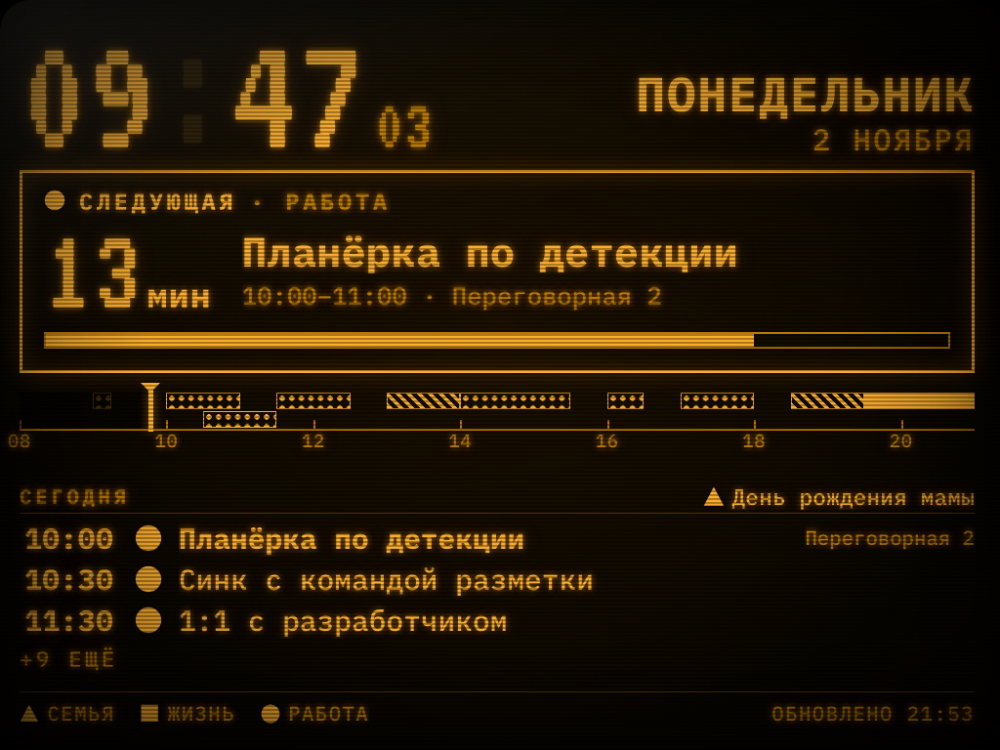
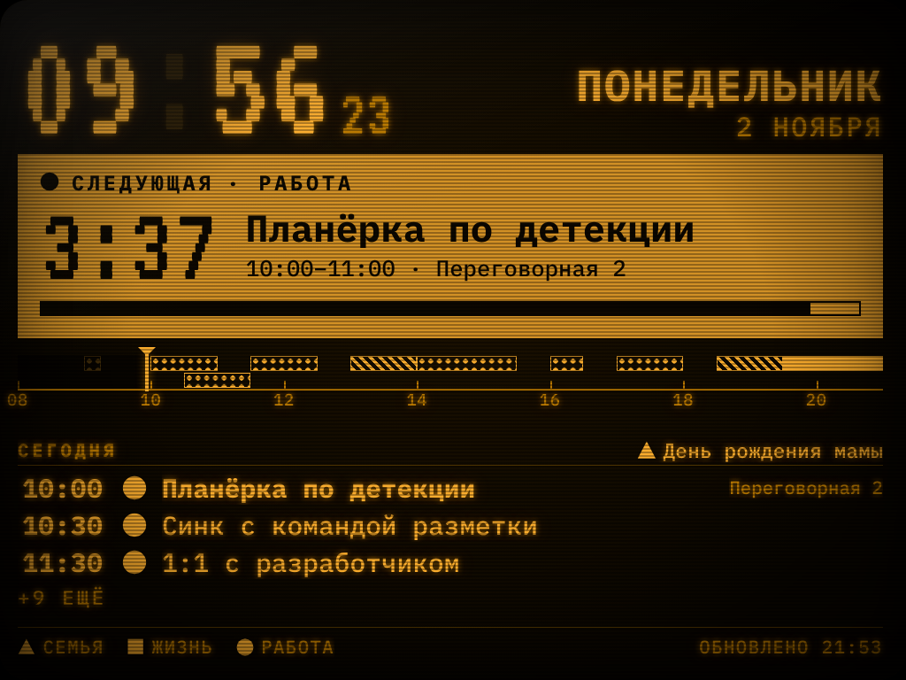
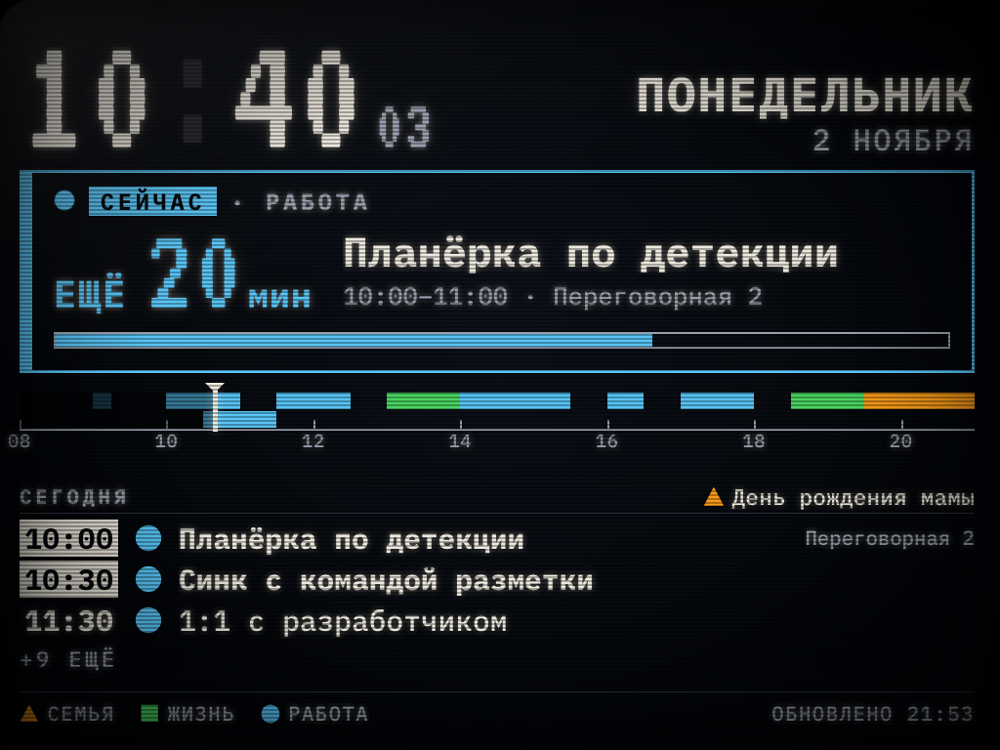
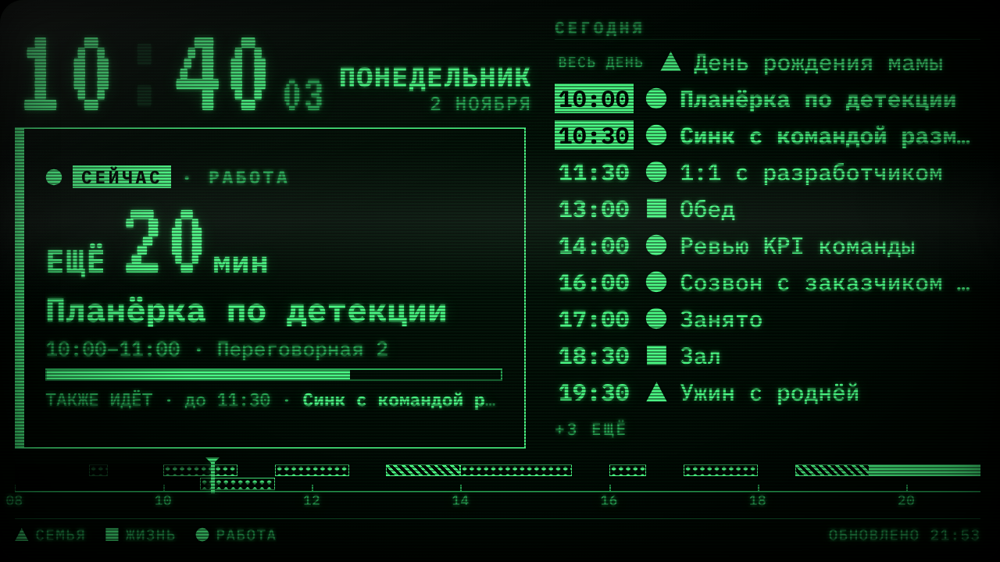

# Ламповый календарь

Расписание из Яндекс Календаря на маленьком мониторе: крупные часы, обратный отсчёт до ближайшей встречи, полоса дня, повестка на несколько дней, ЭЛТ-эффекты. Сервер крутится на Raspberry Pi, экран открывается в обычном браузере.



| До встречи 5 минут | Встреча идёт | Широкий экран |
|---|---|---|
|  |  |  |

## Установка на Raspberry Pi

```bash
# скопируйте папку на малинку, затем:
cd yandex-crt-calendar
./deploy/install.sh          # окружение + systemd-сервис, порт 8080
```

Нужен Python 3.10+ (в Raspberry Pi OS Bookworm он есть). Без сервиса: `./deploy/install.sh --no-service`.

Дальше:

1. Откройте `http://<IP-малины>:8080` и **зарегистрируйтесь** (логин и пароль — только для этого приложения).
2. На странице настроек подключите Яндекс (см. ниже), выберите календари и внешний вид — справа живой предпросмотр.
3. Скопируйте «Адрес для монитора» и откройте его в браузере на мониторе. Вход не нужен: ключ зашит в адрес.

Чтобы браузер сам открывал экран при включении — `deploy/kiosk.sh "<адрес>"`. Автозапуск в Raspberry Pi OS: положите в `~/.config/autostart/yacal.desktop`

```ini
[Desktop Entry]
Type=Application
Name=Ламповый календарь
Exec=/home/pi/yandex-crt-calendar/deploy/kiosk.sh "http://localhost:8080/d/ВАШ_КЛЮЧ"
```

## Как подключается Яндекс

У Яндекс Календаря нет REST API — доступ только по CalDAV (`caldav.yandex.ru`), и Яндекс пускает туда **только по паролю приложения**, не по основному паролю:

1. <https://id.yandex.ru/security/app-passwords> → «Создать пароль приложения» → тип **«Календарь»**.
2. Скопируйте пароль (показывается один раз).
3. Введите в настройках логин (полный адрес; для Яндекс 360 для бизнеса — адрес на домене организации) и этот пароль.

Пароль приложения хранится в SQLite в зашифрованном виде (Fernet; ключ — `data/secret.key`, права 600) и даёт доступ только к календарю. Сервер опрашивает Яндекс раз в 3 минуты, а монитор — наш сервер раз в 30 секунд, поэтому экран живёт и при коротких обрывах связи (в подвале появится «НЕТ СВЯЗИ»).

## Что есть на экране

- **Часы** с секундами и датой. Время берётся с самой малинки/браузера, секунды и обратный отсчёт тикают без интернета.
- **Главный блок** — что происходит или что дальше:
  - *Следующая* — «12 мин», в последние 5 минут «4:32». Если встреча не сегодня, — «ЗАВТРА 09:00».
  - *Сейчас* — «ЕЩЁ 20 мин» + полоса прогресса встречи.
  - Важность видно издалека и без цвета: за 15 минут рамка светится, за 5 — **инверсия** (светлый фон, тёмный текст, пульсация), в последние 5 минут встречи отсчёт мигает.
- **Полоса дня** — блоки встреч по времени, курсор «сейчас», прошедшее затемнено, пересечения встреч на отдельных дорожках.
- **Повестка** — сегодня и ближайшие дни, идущие сейчас встречи выделены, события «на весь день» — в заголовке дня. Не влезло — «+N ЕЩЁ».
- **Несколько календарей** (слои «работа», «жизнь»…) различаются цветом, **фигуркой** и штриховкой на полосе дня — на одноцветном экране цвет не виден. Для каждого можно задать название, короткое имя, цвет, фигурку, скрыть календарь или скрыть названия событий («Занято»). События с пометкой «приватное» всегда показываются как «Занято».
- Отклонённые вами приглашения скрыты (отключается). Подвал: легенда и время последнего обновления.

## Настройки внешнего вида

Цвет люминофора (янтарь / зелёный / белый / цветной) и сезонные темы — **Осень** (падающие листья), **Хэллоуин** (угольки и пролетающие летучие мыши), **Новый год** (мигающая гирлянда, золотые звёзды, снег), **Зима** (снегопад и морозный фон); есть и **«Авто по сезону»**: 24.10–01.11 Хэллоуин, 15.12–10.01 Новый год, остальная зима — Зима, сентябрь–ноябрь — Осень, в остальное время янтарь. В сезонных темах вместо базовых форм календарей — тематические фигурки (тыква, привидение, ведьмина шляпа, конфета, летучая мышь, паучок; ёлка, подарок, ёлочный шарик, звезда, колокольчик, леденец; снежная горка, снеговик, снежинка, сосулька; жёлудь, гриб, листик, кленовый лист, яблоко, зонтик) — различать календари по форме можно так же, как раньше. Внизу экрана — декорация (кладбище, сугробы с ёлками, ёлки с огоньками, кучи листьев), на Хэллоуин по паутине спускается паучок, а в новогоднюю полночь над экраном салют. Украшения отключаются галочкой в настройках (или `?decor=0` в адресе), цвета темы остаются. Также: сила ЭЛТ-эффектов 0–3 (сканлайны, свечение, виньетка, мерцание, включение «как у кинескопа»), размер текста, поля от краёв (оверскан), раскладка (авто по формату: 4:3 и портрет — столбиком, шире 3:2 — две колонки), число дней, ночное затемнение, лёгкое «плавание» против выгорания, часовой пояс. Масштаб считается от размера экрана, поэтому разрешение не важно — нужный размер текста выбирается ползунком. В предпросмотре можно переключить формат (4:3, 16:10, 16:9, портрет) и «подкрутить время», чтобы увидеть экран перед встречей, во время неё или вечером.

Для проверки состояний можно и прямо в адресе экрана: `?at=2026-11-02T09:47:00%2B03:00`, `?theme=green` (ещё `autumn`, `halloween`, `newyear`, `winter`, `season`), `?decor=0`, `?fx=0`, `?layout=wide`, `?scale=1.2`.

## Безопасность

- Пароли аккаунтов — scrypt. Сессия — httpOnly-cookie, ограничение попыток входа, проверка Origin у изменяющих запросов.
- Адрес `/d/<ключ>` открывает только экран (без настроек). Кто знает адрес и видит вашу сеть, увидит расписание; «Сменить адрес» делает старый недействительным.
- Не выставляйте порт 8080 в интернет без HTTPS-прокси. Закрыть регистрацию после создания своего аккаунта: `YACAL_ALLOW_REGISTRATION=0` (в `deploy/yacal.service`).
- Название событий в календарях с «Занято» скрывается на сервере и не отдаётся экрану.

## Настройки окружения

| Переменная | По умолчанию | Что делает |
|---|---|---|
| `YACAL_DATA` | `./data` | где лежат БД и ключ шифрования |
| `YACAL_ALLOW_REGISTRATION` | `1` | `0` — закрыть регистрацию |
| `YACAL_CALDAV_URL` | `https://caldav.yandex.ru` | другой CalDAV-сервер (например, для проверки на Radicale) |

## Если что-то не так

- **«Яндекс не принял логин или пароль приложения»** — нужен пароль именно типа «Календарь»; только что созданный пароль иногда начинает работать не сразу. Для Яндекс 360 для бизнеса администратор может запретить пароли приложений.
- **«Нет связи с caldav.yandex.ru»** — проверьте интернет и DNS на малинке.
- **Экран пустой** — на странице настроек нажмите «Обновить сейчас», проверьте, что нужные календари отмечены «показывать».
- Логи: `journalctl -u yacal -f`. Обновить программу: заменить файлы и `sudo systemctl restart yacal`; открытый экран подхватит новую версию после ночной перезагрузки страницы (около 4:00) или сразу, если поднять `VERSION` в `app/__init__.py`.

## Устройство

`app/` — FastAPI: `main.py` (маршруты), `yandex.py` (CalDAV → события, повторяющиеся события разворачиваются через `recurring-ical-events`), `service.py` (кэш и фоновое обновление), `db.py`, `security.py`. `static/` — страницы без сборки и без внешних зависимостей: `display.html/js/css` (экран), `settings.*`, `login.html`, `register.html`; шрифты IBM Plex Mono и VT323 лежат локально.
